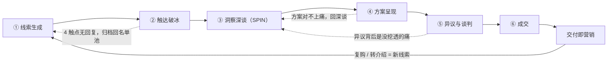

# 课程 04：销售全流程——六阶段作战地图

> **前置课程**：课程 01（底层认知）/ 课程 02（产品化自己）/ 课程 03（市场与客户）
> **预计学习时长**：12–16 小时（含练习；第 2、3 课必须配合真实触达与真实深谈完成）
> **课程性质**：实战核心课。全学院最厚的一门，建议"每周一课 + 当周练习"，分 6 周完成。
> **主线案例**：独立顾问陈默（组合优势：财务业务理解 × Python 自动化）把"对账自动化"服务卖给跨境电商公司"硬壳科技"。六课共用这一条线——你会看到一个真实的单子从 50 人名单走到转介绍成交的全过程。

## 课程目标

学完本课程，你应该能够：

1. 默写六阶段各自的唯一目标与进入/退出标准，并对自己 pipeline 里的每个机会判断"现在处于哪个阶段、卡在哪条标准上"。
2. 独立产出一份 ≥50 人、带痛/钱/达三要素评分与 A/B/C 分级的触达名单，附四周分批触达计划。
3. 写出邮件、微信、LinkedIn 三渠道各两版合格冷触达（通过"前 5 秒原则"五项检验），并设计 Day 1/3/7/14 四触点跟进序列。
4. 主持一场听说比 ≤ 40:60 的深谈，拿到客户亲口说出的量化痛点（金额/时间/风险至少一项），当场完成复述确认；再写出含三档报价的提案，用异议四分类 + LAER + 谈判三原则推进到成交，并在成交后 90 天内执行完"交付即营销"三动作。

---

## 六阶段作战地图



| 阶段 | 唯一目标 | 进入标准 | 退出标准 | 合格信号 | 常见错误 |
|---|---|---|---|---|---|
| 1 线索生成 | 建立高质量名单 | 有 ICP 与 PVP | ≥50 人完成三要素评分与分级 | 每条都有痛/钱/达分数和触达路径 | 名单大而杂；把"认识的人"当客户 |
| 2 触达破冰 | 换来一次对话 | 名单完成分批 | 对方回复并约下时间 | 回复里出现具体问题和时间提议 | 群发模板；上来就推销；无跟进序列 |
| 3 洞察深谈 | 让客户亲口说出痛点和代价 | 对方同意给 30–60 分钟 | 完成复述确认并被认可 | 客户说出量化影响（钱/时间/风险） | 自己讲太多；不问不记；痛点没有数字 |
| 4 方案呈现 | 让客户看到"新状态"且相信可行 | 拿到量化痛点 | 客户给出明确下一步 | 客户开始讨论细节、时间、落地 | 罗列功能与技能清单；报价无结构 |
| 5 异议与谈判 | 在保护价值的前提下达成一致 | 客户对方案表态 | 双方就范围与价格达成一致 | 价格被讨论但没有单方面让步 | 一被压价就降价；把异议当攻击 |
| 6 成交与交付 | 签下来并超预期交付 | 双方达成一致 | 收到全款 + 拿到证言或转介绍 | 客户主动介绍下一个人 | 交付完就消失；不敢要证言 |

**三条使用纪律**：一、一单只有一个当前阶段——用触达阶段的目标（成交）考核自己是错的赛道。二、每周末给 pipeline 里每个机会标注阶段编号与卡住的标准，下一步动作会自动浮出。三、卡住不是加力，是回炉——方案对不上痛、异议解释不掉，九成是深谈没谈透，回第 3 课，不是发更多资料。

术语与结构沿用[主文档第 04 章](../../营销方法论体系.md)；提问与谈判的更多工具见[课程 06：沟通工具箱](../06-沟通工具箱/README.md)。

---

## 第 1 课 线索生成：双引擎与高质量名单

### 讲解

#### 1.1 双引擎模型

| 维度 | Inbound（拉） | Outbound（推） |
|---|---|---|
| 本质 | 作品、文章、开源、口碑，让机会找你 | 名单 + 主动触达，你去找机会 |
| 起速 | 慢（内容→信任→线索以月计） | 快（本周触达，两周内见回复） |
| 持续性 | 复利，睡后运转 | 一次性，停下即归零 |
| 成本 | 前期时间重，后期边际趋零 | 每个线索都付一对一时间 |
| 副产品 | 个人品牌资产 | 真实市场反馈（校准 PVP） |

冷启动期 Outbound 为主的两个理由：现金流等不起 inbound 的滞后；outbound 本身就是市场调研——50 个精准触达的回复与拒绝，比任何闭门推演更能校准你的 PVP。但 outbound 消耗名单、inbound 制造名单，所以从第一天起双轨：每周留 20% 时间做能沉淀的内容（一篇拆解、一个开源小工具、一次公开分享）。

| 阶段 | Outbound : Inbound 精力配比 | 切换信号 |
|---|---|---|
| 冷启动（第 1–3 月） | 80 : 20 | —— |
| 起势期（第 4–9 月） | 60 : 40 | inbound 每月稳定带来 ≥2 个可对话线索 |
| 复利期（第 2 年起） | 30 : 70 或更低 | 转介绍 + 内容线索填满容量，开始涨价排期 |

#### 1.2 名单质量三要素评分（痛 / 钱 / 达）

对名单里每个人按三要素打 1–5 分（与主文档 ICP 评分一致：`痛点强度 × 支付能力 × 可触达性`，任何一项为零即出局）：

| 要素 | 判断问题 | 5 分锚点 | 1 分锚点 |
|---|---|---|---|
| 痛 | 这个问题直接影响 TA 的 KPI 吗？ | 公开抱怨过 / 在招相关岗 / 业务形态必然踩坑 | 只有你有感觉，TA 从没表现出在意 |
| 钱 | 有预算或付费习惯吗？ | 有采购服务先例，营收/融资健康 | 只习惯免费工具，明显节衣缩食 |
| 达 | 能碰到决策者本人吗？ | 有直达路径（引荐人 / 活跃社群 / 内容互动） | 隔三层把关人，无任何入口 |

**分级规则（木桶优先）**：任一项 ≤2 → C 级（暂缓；有提分路径的标 C*，季度重评）；三项均 ≥3 且合计 ≥12 → A 级；其余 → B 级。评分示例（陈默名单片段）：

| 对象 | 痛 | 钱 | 达 | 合计 | 级别 | 备注 |
|---|---|---|---|---|---|---|
| 硬壳科技·财务经理 林薇 | 5 | 4 | 4 | 13 | A | 前同事可引荐，多平台扩张中 |
| 星潮电商·财务负责人 May | 4 | 3 | 4 | 11 | B | 行业群活跃，第一批练手 |
| 飔帆出海·CFO 周航 | 4 | 5 | 2 | 11 | C* | 无直达路径，CFO 圈有弱关系，季度重评 |

#### 1.3 名单分级与分批策略

- **A 级限量触达**：每周取 8–10 个。好名单是弹药，开局打光就没了；A 级回复后的深谈要占大量时间，触达节奏必须给深谈让路。
- **B 级当训练营**：新话术先在 B 级跑 10 个，看回复率再上 A 级。
- **C 级只做内容覆盖，批次纪律并行**：C 级不投入一对一时间，让他们出现在你内容的受众里，季度重评三要素（分数会变：融资了、换岗了、你认识他朋友了）；50 人切 4–5 批，每批 10–15 人用同一版话术——同批次才可比对"哪句话带来了回复"，这是漏斗度量的分母来源。

### 脚本与对话

**名单卡片模板**（一行一人）：

```text
姓名 | 公司/职位 | 渠道来源 | 痛X 钱X 达X | 级别 | 触达路径（具体到引荐人/群/作品）
最近动态（一条只有看了 TA 资料才写得出的信息）| 状态：未触达/序列中/已对话/已归档 | 下一步动作+日期
```

**名单评审对话**（陈默把 120 人名单交给前辈顾问老金）：

1. **老金**：120 人？你准备怎么触达？
2. **陈默**：挨个发消息，一周发完。
3. **老金**：第一排 May，痛打了 4 分，依据是什么？
4. **陈默**：她公司在做 TikTok Shop，肯定有多平台对账问题。……好吧，是"我猜"。
5. **老金**：把所有"我猜"的分数降 1 分再重新分级。名单的价值不在长度，在每行分数你都说得出依据。
6. **陈默**：那大厂那行呢？痛和钱都是 5。
7. **老金**：达是 1。三项相乘，1 乘什么都是 1。C 级，季度再看。降完分你可能只剩 9 个 A——50 个精准名单胜过 500 个垃圾名单，9 个 A 加 B 级练手，够你四周忙的；四周后你的话术和名单会同时升级一轮。

### 常见错误与纠正

| 错误 | 后果 | 纠正 |
|---|---|---|
| 名单大而杂 | 触达量虚高、回复率惨淡 | 每行分数必须有依据，"我猜"降 1 分 |
| 无触达路径就上名单 | 知道他是谁，碰不到他 | "达"的分数=路径具体程度，无路径=1 分 |
| 只加不减 | C 级吃掉 A 级的时间 | 季度重评，果断降级 |
| 冷启动期猛做内容等上门 | 三个月颗粒无收 | 80/20 纪律：内容每周只占 20% |

### 练习

建你自己的 50 人名单（预计 3 小时）：

1. 从存量渠道（前同事/前客户）、平台渠道（垂直社群/内容平台）、事件渠道各凑至少 10 人。
2. 逐人打痛/钱/达分并写依据，猜的降 1 分；按木桶规则输出 A/B/C 三个子表。
3. 为每个 A 级写一行"最近动态"——这是第 2 课冷触达第一句的原料。
4. 排出四周分批计划：第 1 周 B 级 10 人试话术，第 2 周起每周 A 级 8–10 人。

### 自测

1. 冷启动期为什么是 80% Outbound？说出两个理由。
2. 痛 5、钱 5、达 1 的对象定什么级？为什么乘法思维下"达 1"是致命的？
3. A 级名单为什么要限量触达而不是一次打光？
4. C* 与 C 的区别是什么？季度重评评的是什么？

---

## 第 2 课 触达破冰：三要素、序列与归档纪律

### 讲解

#### 2.1 三要素结构逐句拆解（兼微信模板 A：引荐破冰版）

一条合格冷触达 = **关联（为什么找的是你）+ 价值（对你的一句洞察）+ 低门槛 CTA（一个容易答应的动作）**。示例（陈默微信首触林薇）：

```text
林经理你好，我是陈默，咱们都认识张一帆（我前同事，现在在你们隔壁组做后端）。
看到硬壳最近同时上了 TikTok Shop，多平台之后月底对账的口径打架问题通常会爆发——
我们的经验是差异笔数先翻倍，人工追账追到怀疑人生。
我做过一个口径对照加自动勾稽的小工具，帮一家两平台卖家把月末对账从 3 天压到半天。
不急着谈合作，想知道当时踩了哪些坑的话，回一句"聊聊"就行。
```

| 句子 | 要素 | 为什么这样写 |
|---|---|---|
| "咱们都认识张一帆"+"看到硬壳最近上了 TikTok Shop" | 关联 | 引荐人先立住身份合法性；动态细节证明"这不是群发的"，且与她的业务直接相关 |
| "口径打架……差异笔数会先翻倍" | 价值 | 说一个她可能正在经历的具体机制，不是夸自己 |
| "帮一家两平台卖家把 3 天压到半天" | 价值 | 带数字的第三方结果，替代自我形容 |
| "回一句'聊聊'就行" | 低门槛 CTA | 答复成本=打两个字；绝不约"周三 3 点视频会 30 分钟" |

#### 2.2 "前 5 秒原则"的操作检验

发出前过五道关，任何一条不过就重写：

1. **换名测试**：把对方名字和公司换成名单里另一个人，消息是否照样成立？成立=群发感，回炉。
2. **首句三具体**：首句含"他公司/本人的具体动态、具体共同点（引荐人/社群）、他的具体作品"之一。
3. **15 秒读完**：全文朗读 ≤15 秒（邮件约 100 字内，微信 60 字内更佳）。
4. **CTA 唯一且轻**：全文只出现一个请求，答应动作 ≤ 回一句话。
5. **零自我介绍段**：头衔、年限、"资深专业"一个字不出现——个人主页和证据链接会替你说。

#### 2.3 三渠道适配

| 渠道 | 长度 | 语气 | CTA 形态 | 注意 |
|---|---|---|---|---|
| 邮件 | 80–120 字 | 克制，可放链接 | "回个 1，我把资料发你" | 主题行决定打开率：写"关于 TA 的一个观察"，不写"合作洽谈" |
| 微信 | ≤60 字 | 半熟人语气 | 极轻："回个'聊聊'" | 加好友后 24 小时内发首条；忌长语音与连环表情包 |
| LinkedIn | 备注 ≤300 字符 | 专业、国际化 | "Open to a quick chat?" | 先评论 TA 的帖子再加人，通过率显著更好 |

#### 2.4 跟进序列：Day 1 / 3 / 7 / 14（完整序列示例，对象：林薇）

无回复 ≠ 拒绝，但**每个触点必须带新价值**——新资料、新案例、新角度，绝不是"请问考虑得怎么样"。经验上多数回复出现在第 2–4 个触点（经验参考值，用于自我基线对比，不是统计承诺）：

| 触点 | 渠道 | 给什么新价值 | CTA |
|---|---|---|---|
| Day 1 | 微信 | 引荐关联 + 口径坑的机制（全文=2.1 微信模板 A） | 回"聊聊" |
| Day 3 | 邮件 | 一页《三平台对账口径对照表》+ 一个具体问题 | "这两行你们怎么处理的？" |
| Day 7 | 微信 | 同行案例新数字 + 主动降门槛（全文=对话组 2 改进版） | "表先放你这" |
| Day 14 | 邮件 | 换决策视角的新角度："拓平台不加人，对账成本会怎样" | 断舍离式："不在今年清单就告诉我，不再打扰" |

#### 2.5 归档纪律

- 4 个触点（约两周）无回复 → 归档。归档 ≠ 拉黑：记录最后状态，转入"内容覆盖池"，每季度带一次新价值出现（"看到 X 新政策，想到你们可能受影响，附一页笔记"），仍不问"考虑得怎么样"。
- 止损逻辑：第 5 条消息边际回复率趋近于零、骚扰感陡增——你折旧的是未来所有交易的机会。

### 脚本与对话

**邮件模板 A：给价值型**（对象：某 Shopify 品牌财务负责人 May，Day 1）

```text
主题：关于你们 TikTok 店铺对账口径的一个观察

May 你好，看到星潮上个月进了 TikTok Shop（你们公众号写的）。
两平台之后最常见的坑：同一笔退款在两个平台的字段记法不同，
月末勾稽全靠人工洗数——我们的观察是这类差异在大促后会翻倍。
我帮一家同类卖家做过自动勾稽，月末对账从 3 天压到半天（拆解文章：链接）。
想知道当时踩的三个坑的话，回个"1"，我把笔记发你。
```

逐句讲解："你们公众号写的"是换名测试的原料，只有看过她内容才写得出；"大促后会翻倍"给的是一个可验证的机制判断，让她觉得"这人懂行"；"回个'1'"在邮件里比"聊聊"更轻；全文无一句自我介绍，链接替他完成资质证明。

**邮件模板 B：精准提问型**（对方在公开内容里暴露过痛点时用）

```text
主题：你们招聘 JD 里的"对账效率"这一条

周总，看到飔帆在招高级财务专员，JD 里写了"优化月度对账流程"。
冒昧问一句：这个岗位要解决的对账，是平台多口径的问题，还是回款核销的问题？
两个解法完全不同——前者通常用口径字典加自动勾稽，后者多是支付周期错配。
如果是前者，我有一份刚整理的对照表，发你参考，不用有任何后续。
```

逐句讲解：从 JD 切入，招聘信息=公开宣布的痛，"痛"的分数有实据；"是 A 还是 B？"二选一比"聊聊吧"更易获得回复，且答案本身是情报；"不用有任何后续"主动拆除推销预期，降低回复的心理成本。

**微信模板 B：社群破冰**（同群未加好友）

```text
May，同在跨境电商财务群。你上周问"多平台退货的口径怎么对"，
我们踩过：按"订单维度"对永远对不平，得先按"资金流水维度"拉平再回切订单。
整理过一页笔记，要的话回我，加个微信发你。
```

逐句讲解："你上周问……"引用 TA 的原话，是最强的"非群发"证明；直接给答案的一半——价值前置，留一半在笔记里，制造自然的加微信理由：加好友是 TA 满足自己需求的动作，不是给你面子。

**LinkedIn 模板 A：连接备注**（对象：出海 SaaS 的 VP Finance）

```text
Hi Sarah, I read your post on payment reconciliation pain across regional PSPs.
I help cross-border finance teams cut month-end close from days to hours —
here's one tactic from a similar project. Open to connect?
```

逐句讲解：第一句引用她的帖子（关联），第二句一句定位（价值，days→hours 是数字化的结果承诺），最后 CTA=接受好友（零成本）。英文触达同样遵守三要素与 15 秒原则。

**LinkedIn 模板 B：通过后的私信**（连接通过后 24 小时内）

```text
Thanks for connecting, Sarah.
The tactic from that project: reconcile at the cash-flow layer first, then map back
to orders — it killed ~80% of mismatches before they reached your team. Happy to
share the one-pager if useful — just reply "1". Either way, enjoyed your post.
```

逐句讲解：先兑现备注里承诺的洞察（信任的第一笔存款）；CTA 仍是打一个字；"Either way"把姿态放平——不求回报的收尾反而提高回复率。

**对话组 1：微信冷触达（失败版 → 改进版）**

失败版：

1. **陈默**：你好，我是一名拥有 8 年经验的数据自动化专家，精通 Python、SQL、财务系统对接，曾服务多家知名企业。我们提供一站式对账自动化解决方案，功能全面、价格优惠，请问贵公司有相关需求吗？方便约个时间详聊。
2. **May**：（已读，不回复）
3. **陈默**：在吗？看到消息麻烦回复一下哈
4. **May**：（删除好友）

诊断：首句自我介绍（违反检验第 5 条）；"知名企业"零具体；CTA 太重；第 3 条把无回复当成对方失礼——好感清零。

改进版：

1. **陈默**：May 你好，同在跨境电商财务群。上周你问"多平台退货口径怎么对"，我们踩过：按订单维度永远对不平，先按资金流水拉平再回切订单。整理了一页笔记，要的话回我。
2. **May**：要的，谢谢！我们正好月底被这个搞得头大。
3. **陈默**：发你了【文件】。对了，你们现在几个平台？月末对账大概几天？
4. **May**：三个平台，顺利也要四天。
5. **陈默**：四天在两平台以上算典型。笔记第 2 页有个自查表，按它走一遍能先砍掉一半人工核对。哪一栏对不上，随时来问。
6. **May**：好，我看看。月底要是还这样我找你聊聊。

改进版为什么赢：第一句过换名测试；价值前置（先给半份答案）；CTA 轻；拿到回复后只问两个 S 问题收情报、不推销；最后留一个自然的回流钩子。

**对话组 2：Day 7 跟进（失败版 → 改进版）**

失败版（邮件主题：跟进一下）：

1. **陈默**：林经理您好，上周一给您发过消息，不知道您看到没有？我们的对账自动化方案很有针对性、性价比很高，希望能约 30 分钟给您演示。期待回复！
2. **林薇**：（不回复）

诊断：零新价值，纯催促；"性价比很高"是自我评价；CTA 还是重的"约 30 分钟演示"。

改进版（微信）：

1. **陈默**：林经理，上次提的 TikTok 口径问题，我把它做成了 8 行的对照表，左边是三家平台对同一笔退款的不同记法【文件】。另外刚出炉一个数：上一家自动勾稽上线后第一个大促月，人工追差异从平时的 300 笔降到 40 笔以内。不着急，表先放你这，哪天月末被差异追疯了想起来我就行。
2. **林薇**：哈哈这个形容太真实了。你下周哪天方便？我们聊聊。

改进版为什么赢：两个新价值（对照表+新案例数字）；自嘲式收尾把"不回复"的社交压力从她身上卸掉；结果是她主动约时间——触达阶段的唯一目标（换来一次对话）达成。

### 常见错误与纠正

| 错误 | 纠正 |
|---|---|
| 群发模板改名字 | 过五道检验，第一关"换名测试"就拦下 |
| 上来就推销功能 | 价值前置：先给一个 TA 能立刻用的洞察或资料 |
| CTA 太重（约 30 分钟会议） | 降到"回一个字"；会议是深谈阶段的事 |
| 无回复就发"在吗/考虑得怎么样" | 每个触点带新价值，否则闭嘴 |
| 4 触点后仍不肯归档 | 归档是纪律不是情绪；季度激活留给未来 |

### 练习

1. 为你的 A 级名单写出邮件、微信、LinkedIn 各一版冷触达，逐条过五道检验，写明每条的判定结果。
2. 为其中 3 人设计完整的 Day 1/3/7/14 序列，列出每个触点的新价值是什么、从哪来（案例库/公开资料/行业事件）。
3. 把改进版对话组 1 发给一位真实 B 级对象，两周后统计序列回复率作为你的基线。

### 自测

1. 三要素分别是什么？哪个要素缺失时消息最像垃圾广告？
2. "前 5 秒原则"五道检验你能默写几条？"换名测试"具体怎么操作？
3. Day 3 和 Day 7 触点的"新价值"如果重复会怎样？
4. 什么时候归档？归档后还能做什么、绝对不能做什么？

---

## 第 3 课 洞察深谈：SPIN 提问与量化痛点

### 讲解

#### 3.1 SPIN 的底层逻辑

SPIN 出自 Neil Rackham 对约 3.5 万个销售访谈的研究（《SPIN Selling》）：大额销售中，成交与提问的**序列结构**高度相关——尤其是把"小问题"放大成"值得花钱的大问题"的那类提问（I 问题）。小生意里有效的"闭合式逼单"，放到大会上反而降低成交。**用提问让客户自己说出的痛，比你指出的痛痛 10 倍**——因为他会把它当成自己的结论去捍卫。

| 类型 | 目的 | 建议配比 | 时机 | 新手错法 |
|---|---|---|---|---|
| S 情境 | 了解现状 | ≈1 成 | 开场；调研能查到的不要问 | 把深谈变成查户口 |
| P 难点 | 让客户说出问题 | ≈2 成 | S 之后自然滑入 | 满足于第一个答案 |
| I 影响 | 放大代价（分水岭） | ≈3 成 | P 之后穷追 | 停在 P，以为"有痛"就够 |
| N 收益 | 让客户自己描述价值 | ≈2 成 | I 问透之后 | 自己抢答价值主张 |

#### 3.2 四类问题库（每题标注适用时机）

**S 情境问题**（调研能查到的别问，只问内部流程与分工；破折号后为适用时机）：① 这块现在谁负责、流程大致怎么走——开场第 2 问，建立全貌；② 用什么工具/系统、数据从哪来——为方案可行性取数；③ 团队几个人、各自管哪段——为量化埋人力基数；④ 上次复盘这个流程是什么时候——探测改进意愿；⑤ 这件事你们内部怎么评价——借他人之口定位问题。

**P 难点问题**（问"哪一步最……"，不问"有没有问题"）：① 这流程里哪一步最花时间——第一个具体痛点；② 哪一步最容易出错——找风险类痛点；③ 大家抱怨最多的是什么——团队情绪温度计；④ 你说"不顺利"，最常见卡在哪——抓住对方的措辞追问；⑤ 如果只能改一件事，你想改哪件——客户的优先级排序。

**I 影响问题**（后果链：影响谁 → 多久 → 多少钱 → 管理层怎么看）：① 如果这一步拖一周，会影响到谁、下游要等你们吗——向下游传导；② 这个问题一年大概占用多少人时——时间量化；③ 拖得最久的一次是什么后果——找历史事故；④ 这个问题不解决，明年会怎样——把"不变"的成本摆上桌；⑤ 这件事会让谁在老板面前不好看——社会/情感任务（JTBD 三层）；⑥ 除了你们，还有哪些部门被连带——扩大问题半径。

**N 收益问题**（I 问透之前不要问，否则价值悬空）：① 如果这问题明天早上消失了，对你们值多少钱/多少时间——让客户自己算 ROI；② 团队会把省下的时间拿去做什么——价值具象化；③ 做到什么程度你会觉得"这钱花得值"——客户定义验收标准；④ 如果月底你能拿到一版经营分析，你会拿它做什么决策——连接情感/社会任务；⑤ 半年后回头看，你希望别人怎么评价这次改动——给 Champion 一句"功劳台词"。

#### 3.3 量化痛点的三种方法

没有数字的痛点，撑不起后面的报价。三种口径至少拿到一种：

| 口径 | 问法 | 林薇案例里的实数 |
|---|---|---|
| 金额 | "拖得最久的一次损失了多少？""这类差错一年大概多少？" | 重复付款 4.6 万、两个月才发现；备货偏差压了十几万资金 |
| 时间 | "几人 × 几天？""你本人的时间占多少？" | 3 人 × 每月 4 天；林薇月末 50% 时间在追差异 |
| 风险 | "最坏会发生什么？谁会知道？" | 明年拓 2 平台不加人，差错只会更多；资金安全暴露 |

#### 3.4 听说比 ≤ 40:60 的训练法

1. **录**：征得同意后录音（"我想回听时别漏掉您说的数字，方便录音吗？"——这句本身就在传递认真）。
2. **打分**：回听，每 5 分钟暂停一次，记这 5 分钟里谁说得多；全场"我说多"的时段超过 1/3 即不合格。
3. **三个纠偏动作**：把陈述句改写成问题（"这个能自动化"→"你们现在这一步是怎么做的？"）；关键问题后**沉默 3 秒**，让答案在安静里长出来；用笔记代替脑记——记不住的焦虑会让你用不停说话来掩饰。注意：点头、"嗯""对"不算倾听，**追问才算**——对方每说一个事实，你至少有一次跟进提问，听说比自然达标。

#### 3.5 深谈笔记模板

```text
【深谈笔记】对象/职务/日期/时长
现状（S）：流程、人员、工具、分工
痛点（P）：逐条列，保留客户原话
影响（I）：量化数字（金额/时间/风险），逐个标出
期望（N）：目标画面与验收标准的原话
决策链：谁疼、谁签、谁用、谁可能反对
预算与流程：金额门槛、审批人、时间窗
JTBD 三层：功能任务 / 情感任务 / 社会任务
下一步：动作 + 时限（谁在哪天前做什么）
```

#### 3.6 结束复述确认

深谈最后一分钟，把听见的一切还给客户：

```text
"我复述一下，你看对不对：你们现状是 X（流程+人数），代价是 Y（钱/时间/风险，
用客户的数字），你希望变成 Z（他的原话），时间上希望在 T 之前，
这事走 A 审批。——哪里我说得不准？"
```

两个细节：用"哪里不准"替代"对吗"——给对方纠错空间，纠出来的偏差往往是最重要的情报；这份被认可的复述，就是下一课提案的大纲。

### 脚本与对话

**完整模拟深谈**（陈默 × 林薇，视频 45 分钟，共 30+ 轮对白；右列逐问标注 S/P/I/N 与提问意图——注意陈默如何在客户的每个答案里找下一个问题的钩子）：

| 轮 | 林薇（客户） | 陈默（提问与意图） |
|---|---|---|
| 1 | ——（开场） | 林经理，先说下今天的方式：我会问得比较多，从现状到影响都会碰，有些可能有点尖锐，您随时打断我，可以吗？——开场设定：请求许可，降低"被推销"的戒心 |
| 2 | 可以，你问吧。三个平台——亚马逊、Shopify、TikTok——各自导报表，财务先做平台和回款的勾稽，再跟 ERP 的库存订单对，最后出差异表。加我三个半人，两个会计各管一边，我复核差异表。 | 你们现在月末对账大致是个什么流程、一共几个人经手、走完一遍要几天？——S×3：只问调研查不到的流程、人力基数与耗时，为量化埋点 |
| 3 | 顺利四天，不顺利五六天。三家平台的报表口径不一致，同一笔退款字段记法都不同，得人工洗数据。 | 你说"不顺利"，最常见卡在哪一步？——P：抓她的措辞，问出第一个具体痛点 |
| 4 | 对不上的时候要一笔笔追，追到运营那边人家还嫌烦。这种差异正常月份两三百笔，大促之后翻倍。 | 除了洗数据，还有哪一步让大家最头疼？这样的差异一个月大概多少笔？——P×2：穷举痛点，并把"头疼"变成可数的量 |
| 5 | 主要是我和会计小周在追。 | 按一个月 300 笔、追一笔平均半小时算，光追差异就是 150 个小时。这些时间最后落在谁身上？——I：现场换算成占用，把镜头推向具体的人 |
| 6 | 月末那两周，我一半时间在这上面。 | 你自己这里面占多少？——I：从团队落到关键人——她就是未来的 Champion |
| 7 | 做分析吧。说难听的，我们只有算账的财务，没有管账的分析。 | 反过来问，如果差异事先被系统拦住、不用追，你省下来的时间会拿去做什么？——N 小试：让价值具象，探她的真实动机 |
| 8 | 618 之后那次追了六天，一笔供应商重复付款四万六，两个月才发现。要等对完账才看得到，等于滞后一个周期。 | 刚才说顺利也要四天。去年有没有出过什么事？——I：挖历史事故，寻找风险证据 |
| 9 | 旺季备货吃过亏，账面库存和实际对不齐，多备了一批货压了十几万，后来打折清的。（说完停了三秒，没再说话） | 这种滞后，除了重复付款还影响过什么？备货这些？——I：向下游传导扩展。【教练批注：她在"算账"。闭嘴让她算完——谁先说话谁先暴露】 |
| 10 | 明年要拓两个新平台，人不加。那我常驻月末加班，差错只会更多。 | 如果明年这时候，对账还是四天、差错还是月末才发现，最坏会怎样？——I：把"维持现状"的成本摆上桌 |
| 11 | 两个会计能腾出来；我一直想给老板出一版哪些 SKU 真赚钱的分析，喊了半年没人有空做。 | 换个方向。假设对账压到半天以内、差异实时报警，腾出来的人和你自己的时间，会优先拿来做什么？——N 正式开场：I 已问透，价值水到渠成 |
| 12 | 对账一天内完成、差异当天出、月底我能拿出分析报告。 | 一年后回头看，做到什么程度你觉得"这钱花得值"？——N：客户定义验收标准——这将写进提案的目标状态 |
| 13 | 两万以上我报 CFO 老周签；最好赶在 11 月大促前。 | 预算这块，这类项目以前怎么走？如果做，希望什么时候见效？——S：收尾必问——决策链与时机窗口 |
| 14 | 挺准的。就是备货那次主要是运营的责任，不全是账的问题。 | 好，我复述一下：三平台月末对账顺利也要 4 天、3 人经手，每月两三百笔差异人工追，你本人月末一半时间耗在这；去年重复付款 4.6 万两个月才发现、备货偏差压了十几万；明年拓两平台不加人。你希望对账一天内完成、差异当天暴露、月底有分析报告，11 月前上线，两万以上走 CFO。——哪里我说得不准？——复述确认：提案大纲在此刻生成 |
| 15 | （可以，发我微信。） | 明白，我记成"信息滞后放大了备货误差"。周三前我把方案和报价发你，先你过目，再决定怎么给老周看，可以吗？——下一步：动作+时限+尊重她的内部流程 |

### 常见错误与纠正

| 错误 | 纠正 |
|---|---|
| 深谈变成产品介绍 | 目标是"客户说出的量化痛点"，你的方案一个字都不该出现 |
| S 问题问一堆 | 调研前置，现场只问查不到的；S 占比 ≤1 成 |
| 停在 P（"我们有这问题"） | 每个痛点至少跟 2 个 I 问题：影响谁、多少、多久 |
| 用自己的数字替客户算 | 数字必须出自客户之口，你只能现场帮乘 |
| 关键问题后怕冷场自答 | 沉默 3 秒是工具不是事故 |
| 不做复述确认直接结束 | 复述=提案大纲+免费的"承诺一致"效应 |

### 练习

1. 把 3.2 的问题库改写成你的业务版本（每类 ≥5 问），标注每问的抛出时机。
2. 找一次真实深谈（B 级对象或朋友扮演），录音回听：算听说比、数客户说出的量化数字个数（目标 ≥3）。
3. 用 3.5 模板做笔记，写一段 ≤100 字的复述确认词，念给对方听并记录纠偏内容。

### 自测

1. 为什么 I 问题是分水岭？停在 P 的深谈后面会死在哪一课？
2. "你们有什么痛点吗"为什么是坏问题？换成哪个问法？
3. 量化痛点的三个口径是什么？各举一个你业务里的问题。
4. 听说比怎么测？"嗯啊式倾听"和"追问式倾听"差在哪？
5. 复述确认结尾为什么问"哪里不准"而不是"对吗"？

---

## 第 4 课 方案呈现：卖"从现状到新状态"的桥

### 讲解

#### 4.1 状态迁移故事：五段结构

| 段落 | 要回答 | 材料来源 | 常见错法 |
|---|---|---|---|
| 1 现状 | 客户在哪里（原话+数字） | 深谈复述确认 | 用你的术语重写客户的世界 |
| 2 目标状态 | 到达后的具体画面+验收指标 | 客户 N 问题的回答 | 罗列你的功能当目标 |
| 3 差距与路径 | 为什么有差距、分几步跨 | 你的方法论 | 一步到位无阶段 |
| 4 证据 | 凭什么信你 | 最接近的案例（SCQA 压缩） | 堆资历、堆形容词 |
| 5 风险拆除 | 为什么可控 | 阶段验收/试点/退出条款 | 回避风险话题 |

#### 4.2 完整示例提案（陈默 → 硬壳科技）

```text
《硬壳科技 · 多平台对账自动化提案》v1

一、我们的理解（来自 9/26 深谈，林薇）：三平台月末对账顺利也需 4 天、3 人经手；
  每月 200–300 笔差异人工追，单笔 10 分钟到半天；林薇月末 50% 时间投入核对。
  已发生代价：供应商重复付款 4.6 万（2 个月后发现）、备货偏差积压十几万资金。
  明年拓 2 个新平台、财务不扩编。
二、目标状态（按你的验收标准）：1) 月末对账 ≤ 1 天（现 4 天）；2) 差异 T+0 报警
  （现滞后一个月）；3) 月底自动产出首版经营分析表（SKU 维度毛利）；4) 11 月大促前上线。
三、差距与路径（6 周，三阶段）：第 1–2 周 口径层——三平台字段口径字典 + 数据接入，
  消除"洗数据"人工；第 3–4 周 规则层——自动勾稽引擎 + 差异工单化，追账从"人找问题"
  变"问题找人"；第 5–6 周 应用层——异常报警 + 分析报表模板 + 移交培训（录屏+文档）。
  需要硬壳投入：财务接口人每周 4 小时；IT 开放平台 API 只读权限。
四、投资与选项（三档）：基础版 4.8 万——单平台（亚马逊）全流程自动化，6 周；
  推荐版 8.8 万——三平台 + 差异报警 + 分析报表 + 3 个月答疑（本方案即此档）；
  尊享版 14.8 万——推荐版 + 新平台扩展预留 + 6 个月护航（Retainer 式）+ 季度复盘。
  另设试点入口：先做"单平台 2 周试点 1.2 万"，试点费在全款中抵扣。
五、为什么是我：前东家内部项目——5 城经销商对账，周 8 小时 → 40 分钟；独立后首单
  ——两平台卖家月末 3 天 → 0.5 天，上线后 6 个月重复付款 0 起。（拆解：链接）
六、风险与保障：1) 每阶段末现场验收，不过关即终止，仅结算已完成部分；2) 试点先行，
  不达标可不进入主合同；3) 数据全程本地处理、可脱敏；API 只读，不写入你们系统。
七、下一步：本周五前反馈意见；下周三 30 分钟过一遍方案，确定是否提报周总。
```

#### 4.3 FABG：技能呈现的句子级结构

F 特征（我掌握 X）→ A 优势（因此能做到 Y）→ **B 收益（对你是 Z）**→ G 反问（把球打回去）。改写示范：

```text
特征式：我熟悉 Python 和财务系统。
FABG ：我用 Python + 财务系统接口做了 5 年对账自动化（F），
      能不换你们现有系统、直接在报表层把勾稽规则自动化（A），
      对你们意味着月末从 4 天回到 1 天，3 个人天回到正事上（B）。
      你们现在最耗人的"追差异"一步，和我做的规则引擎差别在哪？（G）
```

B 是唯一让客户在乎的环节；G 的作用是让方案从"宣讲"变"对话"。

#### 4.4 Challenger 式教学点的构造

公式：**教学点 = 大家以为 X（行业常见信念）+ 其实 Y（被忽视的成本或原因，最好用客户自己的数字）+ 所以 Z（行动含义）**。

```text
教学点 1：大家以为对账慢是"Excel 不行"，其实贵的是差错和滞后——慢只是体感，
  重复付款 4.6 万和积压十几万才是钱（用林薇的数字）。所以先治口径，再谈换工具。
教学点 2：大家以为上了系统财务就省事，其实多数自动化项目第一步就死在数据源
  口径没打通，而不是工具选型。所以本方案 40% 时间花在第 1–2 周的口径层——
  看起来最不出活，其实最值钱。
```

分寸：对事不对人（挑战行业共识，不挑战对方智商）；必须能落成客户的一个具体行动；说完停住让对方消化——Challenger 的"掌控"体现在节奏，不在音量。

#### 4.5 三档报价设计

| 档位 | 定位 | 设计规则 |
|---|---|---|
| 基础 | 能用但明显不完整 | 砍掉差异化部分（如只做单平台），为"价高"的指责提供出口 |
| 推荐 | 你真正想卖的 | 功能完整、利润合理，明确标注"本方案即此档" |
| 尊享 | 锚定 + 少数人买 | 加入 Retainer、扩展预留，让中档显得理性 |

心理机制是锚定：先看见 14.8 万，8.8 万就从"贵"变成"克制"。三档必须同页呈现，绝不分开报。

#### 4.6 提案评审清单（呈现前 10 项自查）

1. 现状段每句话都来自客户原话或深谈数字？
2. 目标状态有可验收指标（≤1 天、T+0、11 月前）？
3. 路径有阶段、交付物、双方投入（不是只有你的产出）？
4. 报价三档同页、中档标注推荐？
5. 每个主张背后有证据（案例数字/作品链接）？
6. 至少一个 Challenger 教学点？
7. 风险拆除 ≥3 项（阶段验收/试点/退出/数据安全）？
8. "专业、资深、丰富经验"类形容词全文 ≤2 处？
9. 下一步只有一个动作 + 一个时限？
10. 数一遍："你们"出现的次数 > "我/我们"？

### 脚本与对话

**方案呈现现场**（陈默对林薇，30 分钟，节选）：

1. **陈默**：先声明，方案里所有数字都来自上周你说的原话，我先念现状部分，有出入随时打断。
2. **林薇**：（看完现状段）这段跟我们自己开会的口径一模一样。
3. **陈默**：那我说一个可能反直觉的判断——大家以为对账慢是 Excel 不行，其实贵的是差错和滞后。慢是体感，那 4.6 万重复付款才是钱。所以我的方案 40% 时间花在口径层，看起来最不出活，其实最值钱。
4. **林薇**：但两周做口径，老板可能会问怎么还没看到东西。
5. **陈默**：好问题。口径字典本身就是交付物——第一周末你们会计就能用它半自动洗数，人工先降一半。（做了什么 → 因此 → 对你们意味着，FABG 收口）
6. **林薇**：三档里你推荐中间档？老周那边肯定要砍价。
7. **陈默**：对，8.8 万三平台加报警加报表。基础档只做亚马逊，但你们的痛一半来自三平台口径打架，砍掉它等于留病根，我不建议；尊享档是为明年拓平台准备的，现在上会浪费。另外想请你帮个忙：呈给老周前，你先标出你自己最想保住的两项——你是天天用的人，你的优先级就是我们谈判的优先级。（识别并武装 Champion）
8. **林薇**：差异报警和分析表，必须保。

### 常见错误与纠正

| 错误 | 纠正 |
|---|---|
| 罗列功能与技能清单 | 每段写"从 X 到 Y"，用客户数字 |
| 现状用自己术语重写 | 复述确认的原话直接粘贴进提案 |
| 报单一价格 | 三档同页，中档推荐 |
| 回避"如果失败怎么办" | 风险拆除主动写，别等对方问 |
| 呈现时从头念到尾 | 每段以客户反应为节点，G 问题随时抛 |

### 练习

1. 用 4.2 的骨架为你的业务写一份完整提案（含三档报价与试点入口），过一遍 4.6 清单。
2. FABG 改写：把下面 5 条特征式自述逐句改写（F/A/B/G 四件套写全）：① 我有 8 年数据分析经验；② 我精通 SQL 和 Python；③ 我做过很多行业的项目；④ 我沟通能力很强；⑤ 我有 PMP 认证。
3. 为你的方案构造 2 个 Challenger 教学点（按"以为 X / 其实 Y / 所以 Z"公式，Y 里尽量用客户数字）。

### 自测

1. 五段结构是哪五段？哪一段直接来自第 3 课的复述确认？
2. FABG 四个字母各是什么？为什么 G 比看起来重要？
3. 三档报价里，低档和"真实功能差"的区别是什么？
4. 教学点公式的三个部件是什么？"分寸"指什么？

---

## 第 5 课 异议与谈判：分类、LAER 与 Voss 工具箱

### 讲解

#### 5.1 异议四分类：先诊断，后开方

| 类型 | 本质 | 判别信号 | 应对方向 | 错误应对 |
|---|---|---|---|---|
| 误解 | 信息不足 | 对方陈述的事实有误（"你们只支持表格吧"） | 澄清 + 证据，语气给台阶 | 嘲笑对方不懂 |
| 怀疑 | 不信你做得到 | 事实认可但存疑（"两周上线？真行吗"） | 案例 + 降风险结构（试点/验收/保证） | 拍胸脯发誓 |
| 真实短板 | 你确实不满足 | 需求真实且你没有（"要 SAP 深度集成"） | 承认 + 组合方案（合作/缩范围/换赛道） | 硬接下然后交付翻车 |
| 拖延 | 不痛或不急 | 全盘认可但不动（"都挺好，Q3 再说"） | 回 I 问题，把"不变"的成本摆上桌 | 讲更多功能 |

不确定类型时先问再答——分类探针："您说的贵，是超出预算了，还是觉得收益没到这个数？"一句探针让真实异议自己浮出来。

#### 5.2 异议应对库（12 条）

| 异议 | 真实含义 | 应对骨架 | 话术示例 |
|---|---|---|---|
| 太贵了 | 价值未证明或预算错位 | 探针分叉 | "您说的贵，是超预算，还是不确定收益？咱们分开看。" |
| 我再想想 | 有未说出的顾虑 | 点名选项 | "应该想。您主要卡在哪块——效果、价格，还是时机？" |
| 现在没预算 | 优先级不够 | 假设 + 问周期 | "如果预算不是问题，您想什么时候启动？明年预算几月定？" |
| 我们自己能做 | 信任不足/没算机会成本 | 认同 + 摆坑 + 小入口 | "很多团队这么开始过，最常见的坑是口径层返工三次。我可以用两周试点帮你们把坑标出来，做不做得动你们再决定。" |
| 别人比你便宜 | 比价逻辑 | 拆范围 | "方便把对方范围发我吗？砍掉报表我也做得到便宜，但差异报警一没，你们回到月末人肉。" |
| 要和老周商量 | 真流程或借口 | 递武器给 Champion | "应该的。我准备一页给他看的版本——他最关心哪两点？" |
| Q3/年后再说 | 不急 | 回 I 问题 | "没问题。只想确认：拓平台后差异翻倍这事，Q3 之前会不会先爆？" |
| 你们没做过我们这行 | 怀疑迁移性 | 认同 + 相邻证据 | "直接经验确实没有。相邻案例是 X，可迁移的是方法论这六成，行业那四成我用两周调研补，调研不收费。" |
| 上家把我们坑过 | 信任受损 | 标注情绪 + 验证结构 | "那段经历让您对'承诺'变谨慎了。那我们把'信不信'换成'验不验'：每阶段验收，不过关就终止。" |
| 先免费出个方案 | 白嫖风险 | 小额试点替代 | "完整方案要基于口径调研，那个本身就是交付物。我先免费给一页自查表，两周试点 1.2 万抵全款。" |
| 我还要比两家 | 决策流程正常 | 加速对比 | "应该比。给您一份对比清单：口径、验收、退出条款——拿着问谁都行，比完有问题我随时答。" |
| 能保证效果吗 | 风险厌恶 | 不保证结果，保证过程 | "我不承诺结果，我承诺过程和退出权：阶段验收不过就终止、只结算已完成部分。敢这么写，是因为上个项目就是这么过来的。" |

#### 5.3 LAER 循环：完整对话演示

L 倾听完不抢答 → A 承认感受 → E 探究真实问题 → R 针对性回应（结构来自 Sandler 传统）。

1. **老周（CFO）**：小陈，方案做得挺细。但说实话，8 万 8 对我们这个体量太贵了，我们一年软件总盘子也就这个数。
2. **陈默**：（停两秒，让对方的话落地）。【L：不抢答，给异议完整落地的空间】
3. **老周**：而且省时间这事，财务的时间又不能拿去卖钱。
4. **陈默**：换我是您，第一次跟个人顾问合作，也会先盯住总价。您说的贵，是超了这次预算，还是觉得收益没到这个数？【A 承认感受 + E 探究：先分类再回应】
5. **老周**：都有吧。老板给我划的是 6 万。
6. **陈默**：明白，6 万是这次的线，我记下了。那看收益这半边：上个月 300 笔差异、4.6 万重复付款两个月才发现——这种账在您 CFO 视角里怎么归类？【E：把价值拉回他自己的数字】
7. **老周**：那种事当然要避免，但那是极端年景，不代表年年有。
8. **陈默**：您说得对，不能拿极端年景做决策。那只算确定项：每月 12 个人天的对账压到 2 天内，一年释放一百多人天，这部分每个月都在发生。【R：退到保守口径，只回应"收益存疑"】
9. **老周**：……如果先只做两个平台呢？TikTok 我们明年才重点做。
10. **陈默**：可以谈，那就是范围问题不是折扣问题——我们到谈判桌上拆。【R：把"砍价"重定义为"改范围"，守住价格完整性】

#### 5.4 谈判准备清单

**BATNA 工作表**（谈前必填）：

```text
我的 BATNA：本月 pipeline 还有 2 个 B+ 级机会（其中 1 个已约深谈）；
           推迟到下季度 = 损失 6 周排期，但不必降价。
对方的 BATNA：自己开发（估 3–4 个月 + 试错风险）/ 换供应商重走信任流程。
我的底线：6 万（两平台版），低于此宁可去做 B 级名单。
对方预算线（已知情报）：6 万（老周上报口径）。
结论：我方 BATNA 尚可，无需恐慌；焦点从"总价"转向"范围与结构"。
```

**ZOPA 估算**：我的可接受区间 [6.0, 8.8] 万；推测对方区间 [5.5, 7.0] 万 → ZOPA ≈ [6.0, 7.0] 万（两平台口径）。谈中用试探校准，不亮底牌。

**可交换变量清单**（让步必须换回东西）：

| 我可以给 | 我想换回 |
|---|---|
| 缩范围（去报表/培训） | 保住单价与利润 |
| 价格下探 | 预付比例提高（30%→50%） |
| 价格下探 | 案例授权 + 实名 |
| 锁价二期（TikTok） | 本期签约 + 明年预算占位 |
| 延长答疑期 | 转介绍 2 个人名 |

#### 5.5 Voss 工具箱（Chris Voss《Never Split the Difference》精要展开）

**技巧一：校准问题——用"怎么/什么"替代"为什么"**。"为什么"自带质问感；校准问题把问题抛回给对方帮你解决。

1. **老周**：你们凭什么比软件公司还贵？
2. **陈默**（错误示范）："因为我们更专业。"——对抗升级，谈话结束。
3. **陈默**（正确示范）：这个对比怎么权衡，我想先听您的角度——您是拿我跟成品软件比，还是跟外包团队比？

**技巧二："如何"式提问——让对方替你解决你的问题**。

1. **陈默**：预算 6 万这条线我记下了。那我怎么才能让这个项目在 6 万内启动、又不把 TikTok 的口径问题留到明年？您比我清楚哪边弹性大。
2. **老周**：……TikTok 明年 Q1 才重点做，可以先放。
3. **陈默**：好。两平台版我做到 6 万整，TikTok 二期 3 个月内按 2.4 万锁价，这个数我现在写进合同。

**技巧三：标注情绪——说出对方没说出口的感受**。标注 = "听起来/看起来 + 情绪命名"，让对方感到被看见，情绪降温后事实才有空间。

1. **林薇**：说实话，去年那家服务商 demo 很好看，交付就变样。
2. **陈默**：听起来那段经历让你们对"承诺"这两个字变得很谨慎——不是不想动，是怕再信错一次。
3. **林薇**：对，就是这种感觉。
4. **陈默**：那我们把"信不信"换成"验不验"：每阶段末你们亲手验收，不过关就终止、只结算已完成部分。风险放进流程里，不押在我人品上。

**技巧四：绝不全额分裂差价**。"各让一半"是最懒惰的谈判——它向对方证明你的报价有水分。差价永远用**内容**拆解，让步永远换条件。

1. **老周**：8 万 8 太高，7 万，今天就能定。
2. **陈默**（错误示范）："那各让一步，7 万 9？"——自证报价虚高，且没换回任何东西。
3. **陈默**（正确示范）：7 万和 8 万 8 之间不是数学题，是内容题——咱们拆开看，哪部分您其实用不上？
4. **老周**：报表和培训，我们自己能弄。
5. **陈默**：好，去掉这两块、保三平台加差异报警，是 7 万 6；再低就得砍平台，砍平台留病根。如果 6 万是死线，我换一种补法：您给案例授权加两个转介绍名字，我按 6 万整做两平台版，TikTok 二期锁价 2.4 万。
6. **老周**：转介绍不打包票，名字我出。
7. **陈默**：成不成看我自己，您肯引路就行。6 万整、预付 50%、本周启动？

最终成交结构：两平台 6 万整 + 预付 50% + 案例授权 + 2 个转介绍 + TikTok 二期锁价 2.4 万——价格让了，但每一分让步都换回了东西，且总盘子（6 + 2.4 万）高于裸价成交的底线。

### 常见错误与纠正

| 错误 | 纠正 |
|---|---|
| 一被压价就降价 | 让步必须交换；先重定义"范围题"还是"价格题" |
| 把异议当攻击，条件反射式辩解 | LAER：先 L 和 A，情绪落地再回应 |
| 不分类就背话术 | 四分类 + 探针，对症下药 |
| 对"拖延型"讲更多功能 | 回 I 问题——不动的本质是不够痛 |
| 真实短板硬接 | 承认 + 组合方案；接做不到的活是品牌折旧 |
| 无准备上场 | BATNA / ZOPA / 变量清单三件套谈前必填 |

### 练习

1. 把 5.2 的 12 条异议库改写成你的行业版本（每条：真实含义/骨架/你自己的话术），再补 3 条你实际遇到过的异议。
2. 挑一个在谈的真实机会，完整填写 BATNA 工作表 + ZOPA 估算 + 可交换变量清单。
3. 角色扮演：让朋友/AI 扮演"只肯出预算七成的 CFO"，规则是你全程不许说"各让一半"，练 3 轮后复盘你换了几个变量。

### 自测

1. 四类异议各举一个判别信号；"都挺好但 Q3 再说"是哪类、怎么应对？
2. LAER 四步各是什么？哪一步最常被跳过、代价是什么？
3. BATNA 和 ZOPA 的区别？为什么 BATNA 越硬越不需要技巧？
4. "各让一半"错在哪？正确的替代动作是什么？

---

## 第 6 课 成交与交付即营销：最后一厘米与下一轮第一公里

### 讲解

#### 6.1 成交信号清单

| 类别 | 信号 |
|---|---|
| 言语类 | 开始用"我们"指你方案里的东西；复述你的价值给别人听；主动谈时间（"赶得上 11 月吗"） |
| 行为类 | 把方案转给同事/CFO；主动要合同或条款；邀请你见决策者；讨价还价（砍价=想买） |
| 提问类 | 问细节：怎么开工、要我们配合什么、出问题谁负责、付款怎么走、你们后排期到几号 |

信号出现 ≥2 个即进入成交窗口。此时最大的错误是**重新推销**——把已经决定的人再推回犹豫。

#### 6.2 假设推进法：示例与分寸

1. **林薇**：老周批了，6 万那版。你们什么时候能开工？——【提问类 + 行为类信号】
2. **陈默**：如果我们本周四启动，第一周先做口径调研，需要财务接口人每周 4 小时、IT 开 API 只读权限。人选你定，还是我来提需求？（假设合作成立，只谈执行）
3. **林薇**：我来安排，接口人用小周。
4. **陈默**：好，明早我把合同和首期 50% 账单发你，周四上午跟小周对一次权限清单。对了，如果还有哪里要确认，现在提最合适——开工后再改范围就麻烦了。（留反悔出口的"最后确认"，同时防口头没说清的隐患）

分寸三条：信号不足时硬推进=骚扰；只推进流程细节，不复述卖点；永远留一个"现在说不还来得及"的出口——它既保护对方，也保护你。

#### 6.3 小额试点 → 扩大：成交结构设计

把"信不信你"这个大决定，拆成"值不值得 1.2 万看看"的小决定。设计规则：

1. **范围小但有代表性**：单平台对账——小到决策轻，代表性足到结果可外推。
2. **验收指标事前写死**：对账时间、差异拦截数、上线天数，试点结束对照打分。
3. **时限短**：两周。拖长的试点=免费咨询。
4. **价格计入全款**：试点 1.2 万进主合同全额抵扣——对方心理从"花钱试错"变"提前付分期"。
5. **扩大时点预设**：试点验收会即主合同谈判桌——数据、热情、CFO 都在场。
6. **看决策链的金额门槛定价**：试点价 1.2 万刻意落在林薇 2 万审批权限内——她不必先说服老周就能让你进场。

#### 6.4 交付即营销三动作

**动作一：超预期时刻的设计**。原则：与核心价值相关、计划外、成本低而感知高、出现在交付中后段。本案：老周砍掉了报表和培训 → 陈默交付时仍附赠一页 SKU 分析模板 + 一段 15 分钟操作录屏（成本约 2 小时），验收会上 CFO 亲手点开——被砍掉的东西以礼物形态回归，直接种下二期的需求。反例：送月饼、送周边——与核心价值无关的礼物换不来记忆点。

**动作二：要证言（含提词框架）**。时机：验收通过、对方刚夸你的 48 小时内。

```text
"林经理，验收数据你都看到了。想请你帮个小忙：给一段评价，给后来犹豫的客户看。
不用夸我，就按这个框架说三句——
1）当时的情况：月末对账什么样；
2）现在变了什么：数字对比（4 天→1 天、300 笔→当天拦截）；
3）一句话：你会怎么跟同行介绍这件事。
方便的话带上公司名和职位，不愿意实名也完全没问题。写好发我，格式我来整理。"
```

给框架=替对方省脑力；"格式我来整理"=你拿到润色权；给匿名选项=降低答应成本（实名是加分项不是必选项）。

**动作三：要转介绍**。时机与证言同一窗口（满意度峰值）。问"哪 3 个人"，不问"有没有人"——开放式问题的答案是"我想想"，然后没有然后；并替介绍人把话说好：

```text
"这轮合作你满意的话，想请你帮个更大的忙：你圈子里哪三个人的团队，
也在被多平台对账折磨？不用替我约，你把这段话转给他就行——
'我们找陈默把月末对账从 4 天做到 1 天、差异当天拦截，他下周有两天空档，
可以直接找他聊：联系方式。'介绍人只负责转发，成不成是我的事。"
```

转介绍线索的成交率通常是冷线索的数倍（主文档经验判断）——它是下一轮第 1 课名单的最高质量来源。

#### 6.5 交付后 30 / 60 / 90 天客户节奏

| 时点 | 动作 | 目的 |
|---|---|---|
| 30 天 | 回访接口人：跑一个月真实数据；发一页"上线后首月对比" | 用数据坐实价值；使用问题趁早发现 |
| 60 天 | 成效复盘会（拉上决策者）：对照验收指标逐项打分；现场要证言+转介绍 | 满意度峰值出现在"看见数字"的时刻 |
| 90 天 | 季度回顾：TikTok 二期提案（锁价到期前）；提议轻量 Retainer（每月巡检+口径更新） | 把项目客户变成订阅客户 |

节奏纪律：每个触点仍要带价值（数据、发现、新洞察），否则与"售后骚扰"无异。

### 脚本与对话

**60 天复盘会节选（要证言 + 要转介绍）**：

1. **陈默**：这是上线后两个月的对账数据：11 月对账 0.8 天、12 月 0.5 天，差异拦截 214 笔和 187 笔，重复付款 0 起。
2. **老周**：比我想的好。尤其那个报警，运营现在自己盯着改。
3. **陈默**：那我厚着脸皮要两样东西。第一，一段评价给后来的客户看，框架我发你了——按"当时情况、现在变化、一句话介绍"三句就够，带数字最好。
4. **老周**：行，我让林薇整理。
5. **陈默**：第二样更重要：你圈子里哪三个财务负责人，也在被多平台对账折磨？你只管把我那段话转出去，成不成看我自己。
6. **老周**：跨境母婴那个品牌的财务总监，上个月还跟我吐槽对账。还有两家我回去想想。
7. **陈默**：好，两个名字就够启动了。另外提醒一句：TikTok 二期锁价 2.4 万，3 个月有效期还剩 5 周，Q1 你们重点做 TikTok 的话，这个月启动最稳。
8. **老周**：你把二期方案发来，我排进 Q1 预算。

### 常见错误与纠正

| 错误 | 纠正 |
|---|---|
| 信号出现后继续推销 | 假设推进，只谈执行细节 |
| 合同签完人消失 | 30/60/90 节奏表进日历 |
| 超预期=送无关礼物 | 必须与核心价值相关（模板/录屏，不是月饼） |
| 要证言时说"随便写写" | 给三句提词框架，替对方省脑力 |
| 问"有没有人可以介绍" | 问"哪三个人"，并替他把转发文案写好 |
| 转介绍拿到后冷处理 | 48 小时内带上下文触达被介绍人，并回报介绍人进展 |

### 练习

1. 写出你的成交信号清单个人版（每类 ≥3 条，来自你真实听过的原话）。
2. 为你的服务设计一个小额试点：范围、验收指标、时限、价格与抵扣规则、扩大时点。
3. 改写 6.4 的证言提词框架和转介绍话术为你的业务版本，并设计你的"超预期时刻"（写清成本与预期感知）。
4. 给现有或模拟客户排一张 30/60/90 天节奏表，每行注明该触点带什么价值。

### 自测

1. 三类成交信号各举两条；为什么"砍价"反而是好信号？
2. 假设推进法的"分寸"包含哪三条？
3. 试点的六条设计规则是什么？为什么试点价格要计入全款？
4. 要证言的提词框架是哪三句？为什么必须给框架？
5. 转介绍话术里"哪三个人"比"有没有人"好在哪？

---

## 过关标准

完成全部练习后，逐项打勾：

- [ ] 能默写六阶段总表（唯一目标/进入/退出标准/合格信号），并对 pipeline 每个机会完成阶段标注。
- [ ] 50 人名单完成三要素评分（每分有依据）、A/B/C 分级与四周分批计划。
- [ ] 三渠道冷触达各一版，逐条通过五道检验；Day 1/3/7/14 序列已发出至少一批。
- [ ] 完成一场录音回听的深谈：听说比 ≤ 40:60，拿到 ≥3 个客户亲口说出的量化数字，完成复述确认。
- [ ] 一份完整提案：五段结构 + 三档报价 + 试点入口 + 教学点，评审清单 10 项全过。
- [ ] 异议库个人版 ≥12 条；一次真实谈判前完成 BATNA/ZOPA/变量三件套，全程未做无条件让步，并拿下至少一个成交（任何金额）。
- [ ] 成交客户跑完 30/60/90 节奏，拿到 ≥1 条带数字的证言和 ≥2 个转介绍名字；用 AAR（主文档第 08 章）复盘最有代表性的一单，把一条教训写进自己的话术库。

## 常见错误（课程级）

1. **用错阶段的目标考核自己**：触达期追求成交，深谈期推销方案——每个阶段的唯一目标见总表。
2. **跳过深谈直接报价**：没有量化痛点的报价是猜，被砍价时你没有弹药。
3. **把流程当剧本一字不差地演**：地图是导航不是铁轨，卡住就回上一阶段，而不是在错误位置加力。
4. **所有阶段都在"说"**：从触达到成交，进展几乎都来自对方说的那 60%。
5. **单点作战不建系统**：一次成功靠运气，十次成功靠名单、话术库、异议库、复盘节奏的复利。
6. **交付后失联**：复购与转介绍是个人生意唯一可持续的引擎，失联等于亲手熄火。

## 延伸阅读

- [主文档：营销方法论体系（第 04 章为本课骨架）](../../营销方法论体系.md)
- [课程 06：沟通工具箱——提问、倾听、讲故事、谈判](../06-沟通工具箱/README.md)
- Neil Rackham《SPIN Selling》：约 3.5 万个销售访谈的实证研究，I 问题是全书心脏，配合本课第 3 课精读。
- Matthew Dixon & Brent Adamson《The Challenger Sale》：教学-定制-掌控，配合第 4 课教学点部分。
- Chris Voss《Never Split the Difference》：校准问题、标注、"绝不分差价"，配合第 5 课谈判部分。
- Keenan《Gap Selling》与 Maister 等《The Trusted Advisor》：前者强化"卖差距"的底层视角，后者的信任方程解释本课为何处处"先给再要"。
