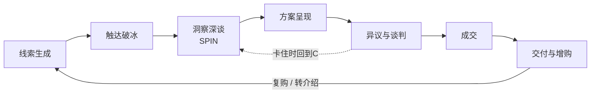

# 营销方法论体系 · 从零重学销售

> **定位**：一套「可执行、可度量、可迭代」的个人销售方法论体系。
> **目标读者**：需要把自己——技能、经验、组合优势——卖个好价钱的人。求职者、自由职业者、顾问、接外包的技术人、想在公司内部推动想法的人。
> **主线**：把自己当产品经营，把销售当系统运行。
> **版本**：v0.2（2026-10-20 起配套[营销学院](营销学院/README.md)——本文是地图，学院是课堂）
>
> 📚 **配套课程**：本文每一章都已展开为学院课程（讲解/案例/练习/自测），见 [营销学院](营销学院/README.md)。

---

## 目录

- [00 本体系如何使用](#00-本体系如何使用)
- [01 底层认知：销售的本质](#01-底层认知销售的本质)
- [02 产品化自己：技能盘点与组合优势](#02-产品化自己技能盘点与组合优势)
- [03 市场与客户：找准愿意付钱的人](#03-市场与客户找准愿意付钱的人)
- [04 销售全流程：六阶段作战地图](#04-销售全流程六阶段作战地图)
- [05 经典方法论地图：六大流派与选用](#05-经典方法论地图六大流派与选用)
- [06 沟通工具箱：提问、倾听、讲故事、谈判](#06-沟通工具箱提问倾听讲故事谈判)
- [07 个人售卖三大实战场景](#07-个人售卖三大实战场景)
- [08 度量与复盘：把销售变成可迭代的系统](#08-度量与复盘把销售变成可迭代的系统)
- [09 90 天学习与实战计划](#09-90-天学习与实战计划)
- [附录 A 模板库](#附录-a-模板库)
- [附录 B 术语表](#附录-b-术语表)
- [附录 C 书单与延伸阅读](#附录-c-书单与延伸阅读)

---

## 00 本体系如何使用

整个体系只回答三个问题：

1. **卖什么** —— 你卖的不是"技能清单"，而是一个能帮人解决问题的**组合优势**（第 02 章）。
2. **卖给谁** —— 谁最痛、最有钱、最容易被你触达（第 03 章）。
3. **怎么卖** —— 一条从触达到复购的完整流程 + 一套可复用的沟通工具（第 04–07 章）。

再用第 08 章的度量体系把它跑成飞轮，用第 09 章的 90 天计划落地。

**使用纪律（重要）**：这不是读物，是训练手册。每学完一章，必须产出一份"个人版"产出物（各章末尾都有工作表）。只读不练，等于没学。

---

## 01 底层认知：销售的本质

### 1.1 销售不是说服，是帮人做决定

新手对销售的最大误解：销售 = 口才好 + 死缠烂打。真相恰恰相反：

- **说服式销售**（推）：我有一个东西，我要让你要它 → 引发防御心理。
- **顾问式销售**（拉）：我帮你搞清楚你的问题值多少、什么方案最合适 → 引发主动购买。

最好的销售过程，是客户觉得"这是我自己想清楚的，你只是帮我看到了"。

### 1.2 三个核心公式

**公式一：客户价值等式**

```
客户感知价值 = (新状态 − 现状) − (价格 + 迁移麻烦 + 决策风险)
```

客户买不买，取决于等式右边是否显著为正。注意三项隐性成本（麻烦、风险）经常比价格本身更致命——这就是为什么"降低风险"（试用、分期、保证、案例证明）常常比"降价"更有效。

**公式二：成交乘式**

```
成交 = 需求匹配度 × 信任 × 时机紧迫性
```

三者是**乘法**关系：任何一项为零，结果就是零。需求不对，再熟也不买（杀熟例外且不可持续）；需求对但没信任，客户会去找别人；需求信任都在但不急，单子会无限拖延。诊断卡住的交易时，先判断死在哪一项。

**公式三：信任方程**（出自 Maister/Green/Galford《The Trusted Advisor》）

```
信任 = (专业能力 × 可靠度 × 亲密度) / 自我导向
```

分母是关键：客户越觉得你"为了自己成交"，越不信任你。提升信任最快的方式往往不是增加专业感，而是**减少自我导向**——敢于说"这个问题不适合我"、敢于帮客户算"不买更划算"的账。

### 1.3 买方决策心理：五个必须记住的现象

| 现象 | 含义 | 销售上的应用 |
|---|---|---|
| 损失规避 | 亏损的痛苦 ≈ 2 倍于等量收益的快乐 | 不说"你能得到什么"，先说"现状每年让你损失什么" |
| 现状偏差 | 人天然偏好维持现状 | 把"不变"重新定义为一种有成本的选择 |
| 社会认同 | 不确定时看别人怎么做 | 用同行业、同规模客户案例替代自夸 |
| 权威效应 | 专家意见降低决策焦虑 | 展示方法论、数据、公开作品而非形容词 |
| 稀缺与紧迫 | 机会越有限越想要 | 用真实的时间窗口（预算周期、排期），不要造假 |

### 1.4 卖自己的三个特殊性

1. **你既是销售又是产品**：你的每次亮相（简历、简历附件、GitHub、朋友圈、会议发言）都是一次提案。
2. **没有"库存成本"但有"品牌折旧"**：时间卖不出去就是沉没的；而一次糟糕的过度承诺，折旧的是你未来所有交易。
3. **复利来自复购与转介绍，不来自单次高价**：个人生意的最佳模型是"少量高质量客户 × 长期关系 × 转介绍"，不是"一锤子买卖"。

**✅ 本章产出物**：用自己的话写一段 100 字的"我对销售的重新定义"，并列出你过去对销售的三个错误假设。

---

## 02 产品化自己：技能盘点与组合优势

> 销售的第一步不是找客户，是搞清楚自己到底在卖什么。

### 2.1 三张资产清单

拿一张表，把自己拆成三类资产：

| 资产类型 | 定义 | 示例 | 格式要求 |
|---|---|---|---|
| 硬技能 | 可验证、可考试、可演示的专业能力 | 编程语言、数据分析、设计、外语、财务建模 | 用"动词 + 对象 + 结果"描述 |
| 软技能 | 在协作中体现的能力 | 项目管理、谈判、公开表达、带人 | 必须有具体故事支撑，否则不算 |
| 经历资产 | 只有时间和经历能给的 | 行业经验（如 5 年供应链）、人脉、踩过的坑、失败项目 | 提炼成"可迁移的教训" |

**动词 + 对象 + 结果** 示例：
- ❌ "熟悉 Python"
- ✅ "用 Python + pandas 把一个每周耗时 6 小时的对账流程自动化，降到 10 分钟"

### 2.2 技能分级与稀缺度评估

每个技能标注四级：`精通 / 熟练 / 会用 / 了解`（诚实地标，市场会替你校准）。

然后问一个残酷的问题：**这项技能在目标市场里，供给有多少？**
- 供给极大（如"会用 Excel"）→ 单独卖不值钱，只能做组合的配料。
- 供给稀缺（如"既懂医疗合规又能做数据工程"）→ 可以作为主卖点。

### 2.3 组合优势：打造稀缺交叉（Skill Stack）

单技能做到全国前 1% 极难；但把两三个各自前 25% 的技能组合起来，你可能在某个交叉点上进入前 1%——因为同时具备的人极少（这一思路来自 Scott Adams 的 "talent stack"）。

**交叉点稀缺度测试**——对你的每个技能组合问三个问题：

1. **同时具备的人多吗？** 在我能触达的市场里，数得出几个？（越少越好）
2. **交叉点有真实需求吗？** 有没有人真的在为这个交叉付钱？（有竞品付费最好）
3. **我能讲清交叉的价值吗？** 30 秒内说不出"1+1 为什么 >2"，市场就不会替你算。

常见高价值交叉模式：

| 模式 | 例子 | 卖点逻辑 |
|---|---|---|
| 领域 × 技术 | 财务 × 编程 → 财务自动化顾问 | 懂业务的技术人比纯技术人贵，比纯业务人快 |
| 领域 × 表达 | 医学 × 写作 → 医学科普/医疗内容 | 稀缺的可靠信源 |
| 技术 × 审美 | 工程 × 设计 → 产品工程师 | 减少handoff、端到端交付 |
| 经验 × 新技术 | 传统行业 × AI → 行业 AI 落地顾问 | 老问题的新解法 |
| 技能 × 语言/地域 | 国内供应链经验 × 海外市场 → 出海服务 | 地域套利 |

### 2.4 个人价值主张（PVP）

**模板**：

> 我帮助 **[具体人群]**，用 **[独特方法/技能组合]**，在 **[时间框架]** 内实现 **[可衡量的结果]**，而且 **[不需要他们担心的事]**。

**示例**：
> 我帮助跨境电商团队，用"数据分析 + Python 自动化"的组合，在一个月内把库存预测的周会人工工作量从 8 小时压缩到 1 小时，不需要他们额外招聘技术岗。

**差异化检验**：让你的竞争对手原样复述你的 PVP，如果毫无违和（"这话我也能说"），说明没有差异化，回到 2.3 重新找交叉点。

**30 秒电梯版**：PVP + 一个数字化案例 + 一个反问（"你们现在这块是怎么做的？"）。

### 2.5 证据资产（Proof Assets）

主张需要证据。按说服力排序：

1. **量化结果**：数字、前后对比（最强）。
2. **作品**：可点开看的东西——代码仓库、作品集、文章、方案文档。
3. **第三方证言**：前客户/前同事/上级的具体评价（带名字 > 匿名）。
4. **资历信号**：认证、学历、公司背书（最弱，只有敲门砖作用）。

**✅ 本章产出物**：
- [ ] 三张资产清单（≥ 各 5 条，用"动词+对象+结果"格式）
- [ ] 至少 3 个候选技能组合，通过交叉点稀缺度测试
- [ ] 一段 PVP + 30 秒电梯陈述（录音并回听）

---

## 03 市场与客户：找准愿意付钱的人

> 卖给错的人，是对的方法论最贵的浪费。

### 3.1 理想客户画像（ICP）三要素

对个人售卖来说，ICP 用三个维度筛：

```
ICP 评分 = 痛点强度 × 支付能力 × 可触达性
```

- **痛点强度**：这个问题让他们睡不着觉 / 直接影响他们的 KPI 吗？
- **支付能力**：有预算（公司）或有积蓄（个人）吗？愿意为这类问题付费的习惯吗？
- **可触达性**：你能通过现有渠道（人脉、平台、社区）碰到决策者本人吗？

三要素缺一，都不是好客户：最痛但没钱的、有钱但碰不到的、碰得到但无痛的，都会消耗你。

### 3.2 JTBD：客户"雇用"你来完成什么任务

客户不是购买产品/服务，而是在"雇用"一个方案去完成一件事（Jobs to be Done，源自 Clayton Christensen）。每个任务有三层：

- **功能任务**：把某件事做完（把报表自动化）。
- **情感任务**：获得某种感受（不再为月底对账焦虑）。
- **社会任务**：在他人眼中的形象（在老板面前显得有掌控力）。

你的报价里，功能任务决定下限，情感和社会任务决定上限——去掉焦虑、让老板放心，客户愿意付的溢价远超"自动化脚本"本身。

### 3.3 痛点三层结构

| 层 | 客户状态 | 挖掘方式 |
|---|---|---|
| 显性痛点 | 说得出口："我们对账太慢了" | 直接问 |
| 隐性痛点 | 说不出但存在："慢导致月底大家都在加班互相甩锅" | 追问影响链（见 SPIN 的 I 问题） |
| 深层痛点 | 恐惧与野心："我怕因此在下一轮裁员中失去位置" | 长期信任 + 时机 |

大部分竞争发生在显性层（比功能、比价格）；隐性层和深层才是差异化报价的空间。

### 3.4 决策链角色

即使卖给自己（求职），对面也往往不是一个"人"，而是一组角色：

| 角色 | 关心什么 | 对应（求职场景） |
|---|---|---|
| 把关人 | 流程、格式、风险 | HR、猎头 |
| 决策者（Economic Buyer） | ROI、团队能力缺口 | 用人部门老板 |
| 影响者 | 技术判断 | 面试官/架构师 |
| 使用者 | 配合是否顺畅 | 未来同事 |

常见死法：只说服了把关人（HR 说"不错"），从没触达决策者。**永远问：这笔交易最终签字的人是谁？他见过我/我的作品吗？**

### 3.5 渠道地图

列出你的 ICP 出没的所有位置，分三类：

- **存量渠道**：现有人脉、前同事、前客户（转化率最高，先挖透）。
- **平台渠道**：招聘平台、垂直社区、行业群、GitHub/公众号/小红书/LinkedIn 等内容平台。
- **事件渠道**：行业会议、线下活动、内推圈。

**✅ 本章产出物**：
- [ ] 写出 2–3 个 ICP 画像（职业、公司规模、痛点、能接触到的渠道）
- [ ] 一份 ≥ 50 人的初始名单（存量渠道优先），标注每个人的"痛 / 钱 / 达"三要素打分（1–5）

---

## 04 销售全流程：六阶段作战地图



每个阶段只有一个目标。新手最常见的错误是用错阶段的目标考核自己（比如在触达阶段就追求成交）。

| 阶段 | 唯一目标 | 合格信号 | 新手常见错误 |
|---|---|---|---|
| 1 线索生成 | 建立高质量名单 | 名单有痛/钱/达三要素评分 | 名单大而杂 |
| 2 触达破冰 | 换来一次对话 | 对方回复并约时间 | 群发模板、上来就推销 |
| 3 洞察深谈 | 让客户亲口说出痛点和代价 | 客户说出量化影响 | 自己讲太多、不问不记 |
| 4 方案呈现 | 让客户看到"新状态"且相信可行 | 客户开始讨论细节/时间 | 罗列功能而非结果 |
| 5 异议与谈判 | 在保护价值的前提下达成一致 | 价格被讨论但不单方面让步 | 一被压价就降价 |
| 6 成交与交付 | 签下来并超预期交付 | 拿到证言/转介绍 | 交付完就消失 |

### 4.1 线索生成：双引擎

- **Inbound（拉）**：作品、文章、开源、口碑，让机会找你。慢但复利，是长期主引擎。
- **Outbound（推）**：主动名单 + 主动触达。快但一次性，是冷启动引擎。

冷启动期 outbound 占 80%，成熟期让 inbound 逐步接棒。**质量 > 数量**：50 个精准名单胜过 500 个垃圾名单。

### 4.2 触达破冰：三要素 + 序列化

一条合格冷触达 = **关联（为什么是你）+ 价值（对Ta的一句洞察）+ 低门槛 CTA（一个容易答应的动作）**。

模板见[附录 A.1](#a1-冷触达模板)。三条铁律：

1. **前 5 秒原则**：第一句必须证明"这不是群发的"。
2. **给价值先行**：先给一个有用的洞察/资源，再提请求。
3. **序列跟进**：没有回复 ≠ 拒绝。3–7 触点、每个触点提供新价值，之后归档。经验上多数回复来自第 2–4 次跟进。

### 4.3 洞察深谈：SPIN 提问法

SPIN（Neil Rackham《SPIN Selling》，基于对 3.5 万个销售对话的研究）是深谈阶段的骨架——**用提问让客户自己说出的痛，比你指出的痛痛 10 倍**：

| 类型 | 目的 | 示例（卖自动化技能给财务团队） |
|---|---|---|
| S 情境问题 | 了解现状（少问，事先调研） | "你们月底对账现在大概是什么流程？" |
| P 难点问题 | 让客户说出问题 | "这个流程里哪一步最花时间？" |
| I 影响问题 | 放大问题的代价（核心） | "如果这一步拖一周，会影响到谁？下游要等你们吗？" |
| N 收益问题 | 让客户自己描述价值 | "如果这步能压缩到一天，对你们团队意味着什么？" |

**深谈纪律**：

- **听说比 ≤ 40:60**——你说的话不超过四成。
- 每个关键痛点必须量化：**多少钱 / 多少时间 / 多大风险**。没有数字的痛点，撑不起后面的报价。
- I 问题是分水岭：新手停在 P（"哦我们有这问题"），高手把 I 问透（"这问题一年 costing 你们 40 万人工"），N 就水到渠成。
- 结束前复述确认："我总结一下，你们的现状是 X，代价是 Y，你们希望变成 Z，对吗？"——这份确认就是你的方案大纲。

### 4.4 方案呈现：卖"从现状到新状态"的桥

不要罗列"我有什么技能"，要讲一个**状态迁移故事**：

1. **现状**（用客户在深谈里说出的原话和数字）
2. **目标状态**（新状态下的具体画面）
3. **差距与路径**（为什么有差距、怎么跨越、分几步）
4. **证据**（做过的最接近的案例 + 数字）
5. **风险拆除**（为什么风险可控：分阶段、可验证、可退出）

技能呈现用 **FABG** 结构：Feature（我掌握 X）→ Advantage（因此能做到 Y）→ **Benefit（对你是 Z 收益）** → Gap Question（"这块和你们现在的做法差别在哪？"把球打回去）。

Challenger 式加成（Dixon & Adamson《The Challenger Sale》）：在方案里带一个**反直觉的教学点**（"大家以为X，其实贵的是Y"），用新视角重塑客户对问题的理解——这比迎合更能建立专家地位。

### 4.5 异议与谈判

**第一步：异议分类**，四类异议应对完全不同：

| 类型 | 本质 | 应对 |
|---|---|---|
| 误解 | 信息不足 | 澄清 + 证据 |
| 怀疑 | 不信你做得到 | 案例 + 降低风险的结构（试点/分期/保证） |
| 真实短板 | 你确实不满足 | 承认 + 组合方案（合作/缩小范围/换赛道） |
| 拖延 | 不痛或不急 | 回到 I 问题，把"不变"的成本摆上桌 |

**第二步：LAER 循环回应**（来自 Sandler 传统的经典结构）：

> **L**isten 倾听完，不抢答 → **A**cknowledge 承认感受（"换我是你也会关心这个"）→ **E**xplore 探究（"您说的贵，是相对预算还是相对收益？"）→ **R**espond 针对真实问题回应。

**谈判三原则**（Chris Voss《Never Split the Difference》精要）：

1. **BATNA 先行**：谈判前想清楚双方的最佳替代方案。你的 BATNA 越硬，越不需要技巧。
2. **让步必须交换**：任何降价/加服务，都要换回点什么（更长期限、预付、案例授权、转介绍承诺）。单方面让步只会教对方压你。
3. **校准式提问**代替对抗：不说"这不合理"，问"我怎么才能让这个价格对您可行？"——让对方帮你解决你的问题。

### 4.6 成交与"交付即营销"

**成交信号**：客户开始问细节（时间、流程、合同、售后）= 心里已经在用。此时用**假设推进法**（"如果我们下周开始，第一步会是……"）顺势收口，不要重新推销一遍把人推回犹豫。

**降低最后一厘米风险**：小额试点 → 满意后扩大，是个人售卖最舒服的成交结构。

**交付即营销**：交付不是销售的结束，是下一轮销售的开始。刻意设计三个动作：
1. **超预期时刻**：至少一个计划外的惊喜点。
2. **拿证言**：在客户最满意的时点，要一段具体评价（给对方提词框架："如果能提到具体数字就更好了"）。
3. **要转介绍**：同一时点问"你觉得你圈子里还有谁有同样的痛？"——转介绍线索的成交率通常是冷线索的数倍。

---

## 05 经典方法论地图：六大流派与选用

| 方法论 | 核心思想 | 最适用场景 | 一句话精髓 |
|---|---|---|---|
| SPIN（Rackham） | 提问引导需求 | 大额、复杂、需要深谈 | 让客户自己说出痛 |
| 顾问式销售 | 先诊断后开方 | 咨询、专业服务 | 医生不开药先检查 |
| Challenger（Dixon & Adamson） | 教学-定制-掌控 | 方案同质化、需差异化 | 带着客户没想过的洞察去 |
| Sandler | 双向资格筛选、痛苦先行 | 防止无效跟进、被客户牵着走 | 不成交也要"不成在早" |
| MEDDIC（Napoli） | 六要素资格清单 | B2B 大单过程管理 | 没有Champion的单是假单 |
| Gap Selling（Keenan） | 卖现状与未来的差距 | 需要量化 ROI | 痛点=现状×(1−满意度) |
| 关系/信任销售 | 长期信任积累 | 长周期、高客单、圈子市场 | 先做朋友，生意是副产品 |

**MEDDIC 六要素**（做大单前的自检清单）：
- **M**etrics 客户可量化的收益是什么？
- **E**conomic Buyer 经济决策人是谁？见过面吗？
- **D**ecision Criteria/Process 决策标准和流程是什么？
- **I**dentify Pain 没有痛，就没有单。
- **C**hampion 内部有没有人主动替你推动？

**选用建议（个人售卖视角）**：
- 求职/接单（中小额、快周期）：**SPIN + 顾问式**为主轴，Sandler 的资格筛选防止你浪费三个月追一个"根本没人疼"的机会。
- 高客单咨询/企业服务：**MEDDIC** 做过程管理 + **Challenger** 做差异化。
- 长期个人品牌市场：**信任销售**，用第 07 章的内容飞轮驱动。

---

## 06 沟通工具箱：提问、倾听、讲故事、谈判

### 6.1 提问技术（超越 SPIN 的补充）

- **标度问题**："1–10 分，你对现状打几分？" → 不管答几分，追问"差 3 分是什么意思？"（自动挖出痛点清单）
- **魔法问题**："如果这个问题明天早上消失了，对你们值多少钱？"（让客户自己完成 ROI 论证）
- **后果链**："这件事拖延一个季度，会有什么连锁反应？"（I 问题的万能展开式）
- **沉默**：问完关键问题后闭嘴。谁先说话谁先暴露——让答案在沉默里成熟。

### 6.2 倾听：3F 过滤器

对方每段话，拆三层接收：**Fact 事实 / Feeling 情绪 / Focus 他真正关心的**。回应时先命名情绪再谈事实（"听起来那次加班让大家挺崩溃的，尤其是……"），信任立刻不同。

### 6.3 讲故事：案例的 SCQA 弧

每个能拿出去讲的经历，按此结构压缩成 90 秒：

> **S**ituation 背景（一句话）→ **C**omplication 冲突（出现了什么问题）→ **Q**uestion 关键问题（当时要回答什么）→ **A**nswer 行动与结果（我做了什么 + 数字结果）→ **启示**（这段经历如何让我能帮到你）。

准备 3–5 个不同主题的 SCQA 故事：一个救火故事、一个从零到一故事、一个失败与复盘故事（失败故事建立真实感，效果常好于成功故事）。

### 6.4 影响力六原则的销售对照（Cialdini《Influence》）

| 原则 | 在销售里的正确用法 | 滥用后果 |
|---|---|---|
| 互惠 | 先给真正有用的洞察/资源 | 给垃圾资料换骚扰感 |
| 承诺一致 | 让客户亲口说出需求和标准 | 逼表态引发逆反 |
| 社会认同 | 展示同类客户的真实案例 | 编造案例，致命 |
| 喜好 | 真诚地对客户这个人感兴趣 | 假装爱好，被识破 |
| 权威 | 公开方法论与作品 | 头衔堆砌，空心 |
| 稀缺 | 真实的排期/时间窗口 | 假紧迫，透支信任 |

### 6.5 谈判速查

- **锚定**：先出合理偏高的数，让谈判围绕你的锚展开（求职谈薪尤其有效：先报"期望区间"而非"当前薪资"）。
- **ZOPA**：成交区间 = 你的底线与对方底线之间。谈前估算双方底线，谈中用试探校准。
- **绝不全额分裂差价**："各让一半"是懒惰的谈判，让步永远要换条件。
- **总包思维**：价格谈不拢时，扩展维度——周期、范围、付款节奏、转介绍、案例授权，总有可交换的变量。

---

## 07 个人售卖三大实战场景

### 7.1 场景 A：求职（把自己卖给一个组织）

- **简历 = 销售文案**：每一条经历都是 FABG，主语是结果不是职责。一页纸，量化优先。
- **面试 = 深谈 + 方案**：前半场 SPIN（问团队的问题、痛的KPI），后半场把你的组合优势对准他的痛呈现。
- **谈薪 = 谈判**：锚定区间、总包思维（base/奖金/期权/远程/成长）、BATNA（手里有 offer 谈判力自动+50%）。谈薪前必须知道市场分位（看同岗位招聘数据、问同行、问猎头）。

### 7.2 场景 B：自由职业 / 咨询（把自己按项目卖）

- **报价四模式**：时薪（起步简单、上限低）→ 按项目（主流）→ 按价值分成（上限高、需强信任）→ Retainer 月费（最稳定、目标形态）。尽早从时薪迁到项目/价值。
- **不报价先深谈**：需求没量化（多少钱/时间/风险）之前不报价——报了也是猜。
- **提案骨架**（见附录 A.4）：现状与代价 → 目标状态 → 路径与交付物 → 价格结构（最好给 2–3 档）→ 风险拆除。
- **三档报价**：中档是你真正想卖的，用低档和高档让它显得合理（锚定的直接应用）。

### 7.3 场景 C：内部卖想法（把自己卖给老板/同事）

- 用**对方的 KPI 语言**写 ROI，不用你的技术语言。
- 小实验先行：用 20% 的投入做出一个能看见的 pilot，让数据替你推销。
- 给决策者"安全的说 yes 方式"：明确要的资源少、可退出、失败归因清晰。

### 7.4 个人品牌：内容飞轮（所有场景的放大器）

```
作品/项目 → 沉淀为内容 → 吸引受众 → 带来机会 → 更好的作品/项目 →（循环）
```

- **选一个主平台深耕**（你的 ICP 在哪里就选哪里），其他平台只做分发。
- 内容配方 = 60% 干货（证明专业）+ 30% 过程/复盘（建立真实与信任）+ 10% 观点（制造记忆点）。
- **弱关系理论**（Granovetter）：新机会更多来自"熟人圈外的泛熟人"。定期激活弱关系——不是群发问候，而是带着具体价值出现（"看到X，想到你在做Y，或许有用"）。

---

## 08 度量与复盘：把销售变成可迭代的系统

> 没有度量，销售只是碰运气；有了度量，销售是可以调试的系统。

### 8.1 个人销售漏斗指标

| 环节 | 指标 | 经验参考区间* | 诊断含义 |
|---|---|---|---|
| 触达 | 回复率 | 5–20%（个性化程度决定） | 低→名单错 or 模板差 |
| 破冰 | 约谈转化 | 回复的 30–60% | 低→CTA 太重 or 价值前置不够 |
| 深谈 | 有效深谈率（拿到量化痛点） | 60%+ | 低→提问技术问题 |
| 方案 | 方案推进率 | 40–70% | 低→方案没对准痛点 |
| 成交 | 成交率 | 20–50% | 低→信任/风险/时机问题 |
| 售后 | 转介绍率 | 目标 30%+ | 低→交付即营销三动作缺失 |

\* 仅为个人售卖的经验参考值，用于自我基线对比：**第 1 个月记录自己的真实数字作为基线，之后只和自己比**。

### 8.2 新手的考核哲学：只考核活动量

前 90 天，结果指标（成交）几乎必然难看——样本太小、运气主导。此时只考核**输入指标**：

- 每周新增触达 N 人（建议 ≥ 20）
- 每周深谈 N 场（建议 ≥ 2）
- 每周复盘 1 次

活动量是新手唯一能 100% 控制的变量，也是转化率的分母来源。

### 8.3 AAR 复盘模板（每个失败/成功的单子都过一遍）

```
1. 结果：成交/失败/搁置？金额/阶段？
2. 过程回放：关键节点在哪一步发生了什么？（触达话术、深谈提问、报价时点）
3. 归因：死在乘式哪一项——需求匹配 / 信任 / 时机？证据是什么？
4. 假设：如果重来，我会改变的一个动作是什么？
5. 沉淀：这个教训能否变成一条写进话术库/清单库的规则？
```

### 8.4 迭代节奏

- **每周**（30 分钟）：漏斗数字 + AAR 一例 + 下周名单。
- **每月**：话术库更新（哪句开场回复率高）、名单策略校准、PVP 微调。
- **每季**：重新做一次第 02 章技能盘点——你的组合优势应该随市场演化。

---

## 09 90 天学习与实战计划

### 第一月：筑基（认知 + 产品化）

| 周 | 学习 | 实战产出 |
|---|---|---|
| 1 | 第 01–02 章；读书《To Sell Is Human》 | 三张资产清单 + 技能分级 |
| 2 | 第 02–03 章 | 候选组合 ≥3 个、PVP + 30 秒电梯陈述（录音回听） |
| 3 | 第 03 章 | 2 个 ICP 画像 + 50 人名单（三要素评分） |
| 4 | 第 04 章触达部分 | 触达模板个人化改写 + 前 10 个触达发出（对象选最不心疼的练手） |

### 第二月：出击（触达 + 深谈）

| 周 | 学习 | 实战产出 |
|---|---|---|
| 5–6 | 第 04 章深谈部分；读《SPIN Selling》 | 每周 20+ 触达、≥2 场对话；每场深谈录音并回听打分（听说比） |
| 7–8 | 第 06 章工具箱 | 3 个 SCQA 故事成稿并口头演练；异议库 v1 |

### 第三月：成交（方案 + 谈判 + 系统）

| 周 | 学习 | 实战产出 |
|---|---|---|
| 9–10 | 第 04 章方案与谈判；读《Never Split the Difference》 | 至少 2 份正式提案/求职方案；一次真实谈判（含谈薪） |
| 11–12 | 第 07–08 章 | 首个成交（任何大小都算）；漏斗基线数据 + 第一次月度 AAR |

### 刻意练习方法（贯穿 90 天）

1. **角色扮演**：找朋友/AI 扮演挑剔客户，每局只练一个动作（比如只练 I 问题）。
2. **录音回听**：每场真实对话听两遍——一遍听自己，一遍数客户说出的痛点数字。
3. **案例拆解**：每周拆解一个身边的成功销售（谁把什么卖给了谁、凭什么），写 5 行笔记。
4. **输出倒逼输入**：每两周把学到的一个框架写成一篇公开内容——既练表达，也喂个人品牌飞轮。

**毕业标准**：90 天后，你有一条真实的漏斗数据、一套个人话术库、至少一个成交/offer、以及一份可以持续运转的周复盘节奏。

---

## 附录 A 模板库

### A.1 冷触达模板

**模板一：给价值型（首选）**

```
主题：关于 [对方公司/项目具体细节] 的一个小观察

[姓名]，看到你们 [最近的具体动态：产品/文章/招聘/公告]，其中 [具体细节] 让我想到一个我们在 [相似场景] 踩过的坑：
[两句话讲清问题和代价，最好带数字]。

我之前用 [方法/组合] 帮 [类似对象] 把 [指标] 从 X 做到 Y（细节可看 [链接]）。

不一定相关，但如果想听听当时的做法，回个"聊聊"就行。
```

**模板二：转介绍 / 弱关系激活**

```
[姓名]，好久没联系！看到 [具体由头]，想到你目前在 [他的领域]。
我最近在做 [一句话 PVP]，刚帮 [类似对象] 完成了 [量化结果]。
你那边或者你认识的人有类似困扰的话，随时拉我进群聊聊。
```

**触达要点**：第一句必须含只有"看了他资料"才写得出的信息；CTA 的答应成本越低越好；第 2–4 次跟进各带一个新价值点（一篇相关文章、一个案例、一个新角度），而非"请问考虑得怎么样"。

### A.2 深谈问题库（30 问速查）

**现状（S）**：这块现在谁负责？流程大致怎么走？用的什么工具？上次复盘是什么时候？
**痛点（P）**：哪一步最花时间？哪一步最容易出错？大家抱怨最多的是什么？如果只能改一件事，你想改哪件？
**影响（I）**：这个问题一年大概占用多少人时？拖过最久的一次是什么后果？影响到哪些下游？管理层怎么看这件事？如果下季度还是这样，会怎样？
**价值（N）**：如果这问题明天消失，值多少钱/多少时间？团队会把省下的时间拿去做什么？做到什么程度你会觉得"这钱花得值"？
**决策与进程**：这件事的预算从哪来？以前买过类似服务吗，体验如何？除了你还有谁参与决定？什么时间点必须解决？

### A.3 异议应对库（起步版）

| 异议 | 真实含义 | 应对骨架 |
|---|---|---|
| "太贵了" | 价值未被证明 / 预算错位 | "您说的贵，是超出预算，还是不确定收益？"+ 回到量化收益或拆分结构 |
| "我再想想" | 不痛 / 有未说出的顾虑 | "完全应该。您主要在想哪一点？是X、Y还是我没提到的？" |
| "现在没预算" | 优先级不够 / 时机 | "如果预算不是问题，这事您想什么时候启动？"+ 问预算周期 |
| "我们打算自己内部做" | 能力自信 / 对你信任不足 | "很多优秀团队也这么开始。已做过的团队最常见的坑是X，我可以在 [小成本介入形式] 上帮你们省掉这个试错" |
| "别人报价比你低" | 采购逻辑 = 比价 | 拆scope："方便发我对方的范围吗？如果砍掉X我也做得到，但Y的差距会……" |
| "我需要和合伙人商量" | 真实流程 or 借口 | "应该的。需要我准备一页给他们看的材料吗？你们最会关心哪两点？"（顺便识别 Champion 是否存在） |

### A.4 提案骨架

```
1. 我们的理解（现状 + 量化代价，用客户原话）
2. 目标状态（完成后的具体画面 + 验收指标）
3. 路径（阶段、交付物、时间线、双方投入）
4. 投资与选项（三档：基础 / 推荐 / 尊享，中档为推荐档）
5. 为什么是我（最相关的 1–2 个案例 + 数字）
6. 风险与保障（分期、试点、退出条款）
7. 下一步（一个具体动作 + 时限）
```

### A.5 周/月复盘表

```
【周复盘 · W__】
触达 __ 人 | 对话 __ 场 | 深谈 __ 场 | 方案 __ 份 | 成交 __
本周最佳动作：__
本周最大教训（AAR）：__
下周名单 Top5 与动作：__
```

---

## 附录 B 术语表

| 术语 | 含义 |
|---|---|
| ICP | Ideal Customer Profile，理想客户画像 |
| JTBD | Jobs to be Done，客户待完成的任务 |
| SPIN | 情境-难点-影响-收益四类提问法 |
| MEDDIC | 大单资格六要素自检清单 |
| Challenger | 以"教学式洞察"驱动的销售流派 |
| LAER | 倾听-承认-探究-回应的异议处理循环 |
| FABG | 特征-优势-收益-反问的呈现结构 |
| SCQA | 背景-冲突-问题-答案的故事结构 |
| BATNA | Best Alternative To Negotiated Agreement，谈判最佳替代方案 |
| ZOPA | Zone of Possible Agreement，可能成交区间 |
| Pipeline | 销售管道/漏斗，各阶段在途机会的集合 |
| Champion | 客户组织内主动替你推动成交的人 |
| Inbound / Outbound | 客户找上门 / 主动找客户 |
| Retainer | 按月订阅式服务费 |

---

## 附录 C 书单与延伸阅读

**必读（按 90 天计划顺序）**
1. 《To Sell Is Human》Daniel Pink —— 破除销售污名，建立现代销售观
2. 《SPIN Selling》Neil Rackham —— 深谈提问的实证圣经
3. 《Never Split the Difference》Chris Voss —— 谈判实战最强可操作性

**进阶**
4. 《The Challenger Sale》Dixon & Adamson —— 差异化与教学式销售
5. 《The Trusted Advisor》Maister/Green/Galford —— 信任方程与顾问关系
6. 《Influence》Robert Cialdini —— 影响力心理机制
7. 《Gap Selling》Keenan —— 以差距为中心的销售观
8. 《You Can Negotiate Anything》/ 查理·芒格《穷查理宝典》（误判心理学章节）—— 心智模型补充

**持续输入**：拆解你所在领域头部从业者的公开内容（他们如何写案例、如何报价、如何讲故事），建立自己的"拆解笔记库"。

---

## 版本记录

| 日期 | 版本 | 变更 |
|---|---|---|
| 2026-10-20 | v0.1 | 初版：完整体系骨架 + 模板库 + 90 天计划 |
